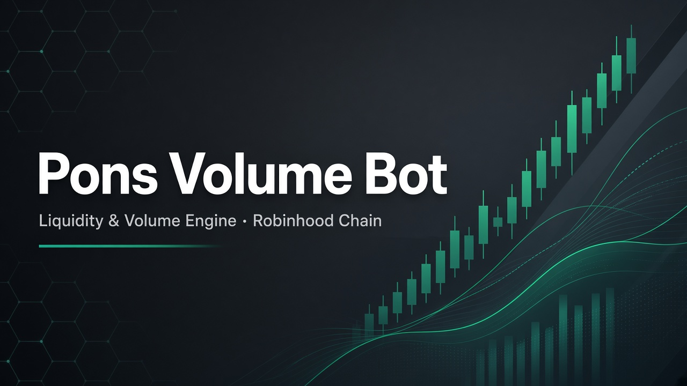

<p align="center">
  
</p>

# Pons Volume Bot

**Automated liquidity and volume engine for [pons](https://docs.ponsfamily.com/) tokens on Robinhood Chain (chain ID `4663`).**

The bot watches Uniswap V3 pools, computes a fair reference price, posts inventory-aware bid/ask quotes, and executes size-capped swaps through the official pons router. Session state — trades, inventory, gas, and PnL — is stored locally in SQLite.

> **Disclaimer:** For education, research, testing, and authorized liquidity work only. Not financial advice. New tokens are highly volatile. Never commit private keys. Only fund wallets you can afford to lose.

---

## Highlights

| Capability | Description |
| ---------- | ----------- |
| Launch awareness | Register a token manually or auto-watch pons factories for new launches |
| Pool telemetry | Track Uniswap V3 swaps, spot price, and buy/sell volume |
| Fair-price model | Rolling window average with volatility-aware spread widening |
| Inventory quotes | Bid/ask that skew with position size and market noise |
| Bounded swaps | Official router + Quoter V2 with configurable slippage caps |
| Risk layer | Position limits, trade cooldown, liquidity floor, daily-loss halt |
| Local analytics | Realized/unrealized PnL, gas spend, and volume in SQLite |
| Safe defaults | Dry-run on by default; live mode needs explicit confirmation |
| Operator view | Periodic console dashboard for quotes, inventory, and PnL |

---

## System Overview

```
                    Robinhood Chain RPC
                             │
                             ▼
                   ┌─────────────────┐
                   │ Launch Monitor  │──▶ Token Registry
                   └────────┬────────┘
                            ▼
                   ┌─────────────────┐
                   │  Pool Monitor   │
                   └────────┬────────┘
                            ▼
              Price Engine ──▶ Quote Engine
                            │
                            ▼
                   Inventory + Risk Gates
                            │
                            ▼
                   Trade Executor (Router)
                            │
                            ▼
                   SQLite Reconciliation
```

### Official pons contracts

| Contract | Address |
| -------- | ------- |
| Active factory | `0xA5aAb3F0c6EeadF30Ef1D3Eb997108E976351feB` |
| Swap router | `0xCaf681a66D020601342297493863E78C959E5cb2` |
| Quoter V2 | `0x33e885eD0Ec9bF04EcfB19341582aADCb4c8A9E7` |
| WETH | `0x0Bd7D308f8E1639FAb988df18A8011f41EAcAD73` |

Reference: [pons documentation](https://docs.ponsfamily.com/)

---

## Requirements

- Python **3.11+**
- Reachable Robinhood Chain RPC endpoint
- Live mode only: wallet funded with ETH (gas) and WETH (buys)

---

## Quick Start

```bash
git clone https://github.com/keidev-sol/pons-volume-bot.git
cd pons-volume-bot
python -m venv .venv
```

Activate the environment:

```bash
# Linux / macOS
source .venv/bin/activate

# Windows PowerShell
.\.venv\Scripts\Activate.ps1

# Windows Command Prompt
.\.venv\Scripts\activate.bat
```

If `python` is unavailable on Windows, use the launcher: `py -m venv .venv` and `py main.py ...`.

```bash
pip install -r requirements.txt
cp .env.example .env
```

Keep `DRY_RUN=true` for the first runs. A private key is not required until you enable live trading.

---

## Commands

Verify RPC connectivity:

```bash
python main.py --connect
```

| Command | Description |
| ------- | ----------- |
| `python main.py --reference` | Dry-run against the official PONS reference token |
| `python main.py --token 0xYourToken` | Trade a specific pons token |
| `python main.py` | Auto-detect new factory launches |
| `python main.py --scan-only` | Discover launches; no trade decisions |
| `python main.py --config path/to.yaml` | Use an alternate configuration file |

Stop with `Ctrl+C`. In dry-run, intended swaps are logged as `[DRY RUN]` and nothing is broadcast.

---

## Configuration

Strategy and chain settings live in `config/default.yaml`. Values in `.env` override selected fields at runtime.

### Strategy parameters

| Key | Default | Meaning |
| --- | ------- | ------- |
| `strategy.base_spread` | `0.03` | Base bid/ask spread (3%) |
| `strategy.price_window` | `12` | Spot samples for fair price and volatility |
| `strategy.max_inventory_tokens` | `10000` | Hard inventory ceiling |
| `strategy.max_trade_eth` | `0.005` | Max WETH per buy |
| `strategy.trade_cooldown_s` | `45` | Minimum seconds between trades |
| `risk.max_daily_loss_eth` | `0.08` | Halt when realized daily loss hits this |
| `execution.max_slippage` | `0.02` | Maximum acceptable slippage |

### Environment variables

| Variable | Purpose |
| -------- | ------- |
| `RH_RPC_URL` | RPC endpoint |
| `PRIVATE_KEY` | Trading wallet (live only) |
| `DRY_RUN` | `true` / `false` |
| `CONFIRM_LIVE_TRADING` | Must be `YES` to broadcast |
| `TARGET_TOKEN` | Optional token address override |
| `BOT_ENABLED` | Emergency stop (`false` freezes trading) |

---

## Live Trading Checklist

Live execution requires **all** of the following:

1. `DRY_RUN=false`
2. `CONFIRM_LIVE_TRADING=YES`
3. `PRIVATE_KEY` set in `.env`

If any check fails, the bot only logs intended actions. Set `BOT_ENABLED=false` for an immediate kill switch.

---

## Repository Layout

```
pons-volume-bot/
├── main.py                  CLI entry point
├── config/default.yaml      Strategy & chain defaults
├── bot/
│   ├── engine.py            Orchestration loop
│   ├── blockchain/          Web3 client
│   ├── pons/                Launch detection & pool reads
│   ├── market/              Price, quotes, liquidity
│   ├── trading/             Executor, risk, inventory, slippage
│   ├── analytics/           PnL and volume
│   └── storage/             SQLite persistence
└── tests/                   Unit tests
```

---

## Tests

```bash
pytest tests/ -v
```

---

## Links

| Resource | URL |
| -------- | --- |
| Repository | [github.com/keidev-sol/pons-volume-bot](https://github.com/keidev-sol/pons-volume-bot) |
| Author | [github.com/keidev-sol](https://github.com/keidev-sol) |
| Telegram | [@Kei4650](https://t.me/Kei4650) |
| Pons docs | [docs.ponsfamily.com](https://docs.ponsfamily.com/) |
| Robinhood Chain RPC | [rpc.mainnet.chain.robinhood.com](https://rpc.mainnet.chain.robinhood.com) |
| Block explorer | [robinhoodchain.blockscout.com](https://robinhoodchain.blockscout.com) |

---

## Support

Questions, setup help, or custom strategy work — reach out on Telegram: **[@Kei4650](https://t.me/Kei4650)**
